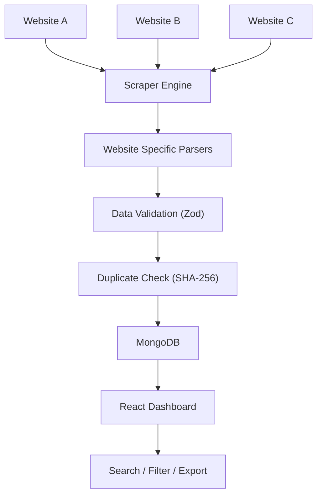

# Business Expo Fetching Software (MERN Stack)

A complete, modern, production-grade **Business Expo Fetching Engine** built using React, Vite, Tailwind CSS, Node.js, Express, TypeScript, and MongoDB.

---

## 🏗️ Architecture & Data Flow



1. **Website Sources**: Configured target URLs with modular parser associations and customizable cron schedules.
2. **Scraper Engine**: Orchestrator executing rate-limited, polite HTTP requests with real browser user agents.
3. **Website-Specific Parsers**: Modular parsers for specific site structures (`EventsEyeParser`, `TradeFairDatesParser`, `BizTradeShowsParser`) and an adaptive heuristic `GenericExpoParser`.
4. **Data Validation**: Strict Zod schema validation ensuring non-empty names, date parsing, location resolution, and status detection.
5. **Duplicate Check**: Deterministic SHA-256 fingerprinting on `(normalized_name | start_date | city | country)` and indexed MongoDB uniqueness to eliminate duplicate records.
6. **MongoDB Storage**: Stores deduplicated expos, source definitions, and execution audit history.
7. **React Admin Dashboard**: Modern UI with real-time stats, source manager, expo listing with multi-filtering, log details modal, and instant Excel / CSV export.

---

## 📁 Modular Project Structure

```
E:\projects\Scraper-Engine\
├── backend/
│   ├── src/
│   │   ├── config/
│   │   │   ├── env.ts                  # Environment variables & runtime settings
│   │   │   ├── database.ts             # MongoDB Mongoose connection
│   │   │   └── seed.ts                 # Verified initial sources seeder
│   │   ├── models/
│   │   │   ├── WebsiteSource.ts        # Source model with custom selector config
│   │   │   ├── Expo.ts                 # Expo model with indexed SHA-256 duplicateHash
│   │   │   └── FetchLog.ts             # Audit trail tracking runs, metrics, errors
│   │   ├── modules/
│   │   │   ├── scraper/
│   │   │   │   ├── interfaces/         # RawExpoData, ValidatedExpoData, IExpoParser
│   │   │   │   ├── parsers/
│   │   │   │   │   ├── BaseParser.ts            # Common HTTP client & date range parser
│   │   │   │   │   ├── EventsEyeParser.ts       # EventsEye directory parser
│   │   │   │   │   ├── TradeFairDatesParser.ts  # TradeFairDates directory parser
│   │   │   │   │   ├── BizTradeShowsParser.ts   # BizTradeShows portal parser
│   │   │   │   │   └── GenericExpoParser.ts     # Configurable CSS selector + heuristic parser
│   │   │   │   ├── parser-registry.ts           # Dynamic parser lookup & auto-resolution
│   │   │   │   ├── validator/expo.validator.ts  # Zod validation & SHA-256 hashing
│   │   │   │   ├── duplicate-detector.service.ts# MongoDB batch deduplication
│   │   │   │   └── scraper-engine.service.ts    # Pipeline orchestrator
│   │   │   ├── sources/                # Controller, routes for source management
│   │   │   ├── expos/                  # Controller, routes for search, filter & stats
│   │   │   ├── history/                # Controller, routes for fetch logs
│   │   │   └── export/                 # ExcelJS (.xlsx) and CSV export endpoints
│   │   ├── services/
│   │   │   └── scheduler.service.ts    # node-cron task manager per source
│   │   ├── app.ts                      # Express app setup & CORS configuration
│   │   └── server.ts                   # Server bootstrap & port listener (5001)
│   ├── package.json
│   └── tsconfig.json
│
├── frontend/
│   ├── src/
│   │   ├── components/common/          # Reusable UI (Button, Badge, Modal, Pagination, Spinner)
│   │   ├── context/
│   │   │   └── ToastContext.tsx        # Toast notification system
│   │   ├── modules/
│   │   │   ├── dashboard/              # StatsCards, RecentFetches, UpcomingExpos, Distributions
│   │   │   ├── sources/                # SourceCard, SourceModal, DeleteSourceDialog, SourcesView
│   │   │   ├── expos/                  # ExpoCard, ExpoTable, ExpoFiltersBar, ExpoDetailModal
│   │   │   └── history/                # HistoryTable, LogDetailModal
│   │   ├── services/
│   │   │   └── api.ts                  # Axios client for all backend endpoints
│   │   ├── types/
│   │   │   └── index.ts                # TypeScript interfaces
│   │   ├── App.tsx                     # Main application layout & tab navigation
│   │   ├── main.tsx
│   │   └── index.css                   # Tailwind CSS styling
│   ├── package.json
│   ├── tailwind.config.js
│   ├── vite.config.ts                  # Vite config with API proxy to port 5001
│   └── tsconfig.json
└── README.md
```

---

## 🚀 Getting Started

### 1. Prerequisites
- **Node.js**: v18+ (verified on v22.16.0)
- **MongoDB**: Running on port `27017`

### 2. Start the Backend
```bash
cd backend
npm install
npm run dev
# Server starts on http://localhost:5001
```

### 3. Start the Frontend
```bash
cd frontend
npm install
npm run dev
# Vite runs on http://localhost:5173
```

---

## 🎯 Key Features Implemented

- **Modern Responsive Dashboard**: Overview metrics (Total Expos, Upcoming, Active Sources, Recent Runs, Industry & Destination breakdown).
- **Website Sources Management**: Add, edit, toggle active status, configure cron schedules, or supply custom CSS selectors.
- **Modular Website-Specific Parsers**: Handlers for EventsEye, TradeFairDates, BizTradeShows, and an adaptive heuristic generic parser for any user-added expo URL.
- **Data Validation & Deduplication**:
  - Validates required fields, normalizes dates, locations, and descriptions.
  - Generates deterministic SHA-256 fingerprint: `sha256(name|startDate|city|country)`
  - Prevents repeated expo records upon multiple runs.
- **Expo Directory**:
  - Live full-text search across name, organizer, venue, city, description.
  - Multi-filtering by Industry, Country, Status (Upcoming, Ongoing, Completed), and Date range.
  - Sorting (Earliest First, Latest First, A-Z, Recently Added).
  - Pagination (customizable limit per page).
- **Expo Details Modal**: Full details with duration, organizer, venue with direct Google Maps link, and external registration links.
- **Instant Export**:
  - **Excel (.xlsx)**: ExcelJS export with styled header, zebra stripes, formatted dates, and auto-filters.
  - **CSV (.csv)**: Clean comma-separated export adhering to current search/filter state.
- **Fetch Audit History**: Duration, items found, new records inserted, duplicates skipped, step logs, and error reporting.
- **Dual Fetch Triggering**:
  - Manual on-demand fetch per source or batch fetch for all active sources.
  - Automatic scheduled background fetching with `node-cron`.
